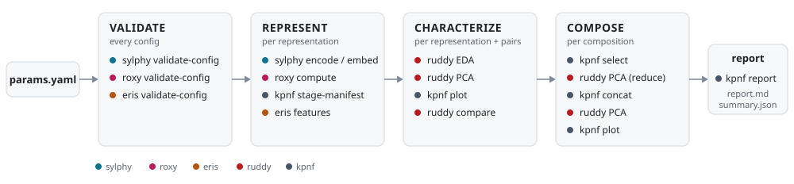

# kaleidoprot-nf

Nextflow pipeline that connects [Sylphy](https://github.com/kren-ai-lab/sylphy),
[Roxy](https://github.com/kren-ai-lab/roxy), [Eris](https://github.com/kren-ai-lab/eris) and
[Ruddy](https://github.com/kren-ai-lab/ruddy): it generates protein representations, characterizes
them, compares representation spaces and composes them into joint feature matrices.

Status: prototype (W5 and a minimal W6 of the KaleidoProt specification). See
[docs/design.md](docs/design.md) for scope, decisions and open points.

## How it works



- **VALIDATE** checks every representation's `--config` with `<tool> validate-config`. No representation starts until every config passed, so a typo fails in seconds instead of after the embeddings.
- **REPRESENT** fans out over `representations`. Each entry names a tool and that tool's own `--config` file.
- **CHARACTERIZE** runs `ruddy inspect univariate` (EDA) and `ruddy project pca` on every representation, plots the PCA coloured by `label_column`, and runs `ruddy analyze representation` (CCA, CKA, Procrustes, Mantel, distance similarity) on the requested pairs.
- **COMPOSE** builds each composition from blocks that are used raw, reduced with a Ruddy PCA (`reduce: N`) or filtered from their Ruddy EDA (`select: true`). `kpnf concat` aligns blocks by id, prefixes columns with the block name and scales them; the result goes through a final Ruddy PCA and a figure.
- **Report**: `report/report.md` and `report/summary.json` summarize everything above.

Rules kept from the specification: rows are aligned by `id`, never by position; nothing is zero-filled or imputed (a block with missing values stops the composition); column names carry the block prefix (`esm2_t6__p_0`); projections come only from Ruddy; every output has a `provenance/1` sidecar.

## Containers (docker and apptainer profiles)

With `-profile docker` or `-profile apptainer`, each process runs the released image of its tool from `ghcr.io/kren-ai-lab` (versions pinned in `modules/`), so only the engine is needed. `SYLPHY_EMBED` uses the `-full` Sylphy image (about 6 GB); the other images are 0.6 to 1 GB. kpnf runs the image of the pipeline release, or `kpnf:main` on a dev version.

```bash
nextflow run . -profile docker,test -params-file examples/test/params.yaml
```

## Install (local profile)

All tools must be on `PATH`. One Python 3.13 environment holds the four libraries plus the `kpnf` glue package (Python 3.14 needs a C compiler because `biotraj` has no cp314 wheel).

```bash
uv venv -p 3.13 .venv && source .venv/bin/activate
uv pip install -r envs/requirements.txt
```

Do not add `--extra-index-url https://download.pytorch.org/whl/cpu` with `--index-strategy unsafe-best-match`: that index carries very old builds of unrelated packages (`six`, `boto3`) and the resolver picks them, which breaks `transformers` at import time.

## Run

```bash
# small public test set: 16 PDB entries, 4 families
python examples/test/fetch_test_data.py examples/test/data
nextflow run . -profile local,test -params-file examples/test/params.yaml

# own data
nextflow run . -profile local -params-file my_params.yaml \
    --input sequences.csv --structures manifest.csv --label_column family --outdir results
```

Add `-profile gpu` (GPU tasks get `accelerator = 1`) or `slurm` as needed; set `device: cuda` in the Sylphy embed config.

## Inputs

| Parameter         | Description                                                                                                                                                                                                                                             |
| ----------------- | ------------------------------------------------------------------------------------------------------------------------------------------------------------------------------------------------------------------------------------------------------- |
| `input`           | CSV/TSV/Parquet with an `id` column and a sequence column (`seq_column`, default `sequence`). Extra columns are allowed, e.g. labels.                                                                                                                   |
| `structures`      | Eris manifest `id,path[,chain,model]`. Relative paths resolve against the manifest. Required only for `tool: eris`. Ids must match `input` (or use `alignment: partial`).                                                                               |
| `label_column`    | Column of `input` used to colour the figures.                                                                                                                                                                                                           |
| `representations` | List of `{name, tool, config[, features_source]}`; `tool` is `sylphy-encode`, `sylphy-embed`, `roxy` or `eris`. `config` holds the tool's options inline, or the path to its `--config` file.                                                           |
| `comparisons`     | `all` or a list of `[x, y]` pairs.                                                                                                                                                                                                                      |
| `compositions`    | List of `{name, blocks, scaling, n_components}`; each block is `{representation, reduce: N}` or `{representation, select: true}` or just `{representation}`. `scaling`: `none`, `standard`, `block` (standardize, then equal total variance per block). |
| `alignment`       | `strict` (default; same ids everywhere or fail) or `partial` (intersection, dropped ids are reported).                                                                                                                                                  |
| `selection`       | `max_missing` (0), `near_constant` (0.99), `abs_rho` (0.90), `method` (spearman), `max_features` (none).                                                                                                                                                |

See [examples/test/params.yaml](examples/test/params.yaml) for a complete example.

## Outputs

```
results/
  representations/   <rep>.parquet|csv + provenance (Eris artifacts in <rep>_artifacts/)
  eda/               eda_<rep>/ (ruddy inspect univariate)
  projections/       pca_<rep>/, pca_block__<comp>__<rep>/, pca_comp__<comp>/
  comparisons/       cmp_<x>__<y>/ (ruddy analyze representation)
  selection/         <comp>__<rep>.selection.csv (kept/dropped and reason per feature)
  compositions/      <comp>.parquet + <comp>.blocks.json
  figures/           <id>.png
  report/            report.md, summary.json, figures/
  pipeline_info/     Nextflow timeline, report and trace
```

## Layout

```
main.nf                    entry workflow
utils.nf                   parameter checks and comparison pairs
modules/<tool>.nf          one file per tool (sylphy, roxy, eris, ruddy, kpnf)
subworkflows/              validate, represent, characterize, compose
python/                    kpnf package (select, concat, plot, report, stage-manifest)
conf/                      resources and test profile
examples/test/             params (with inline tool configs), test data fetcher
```
